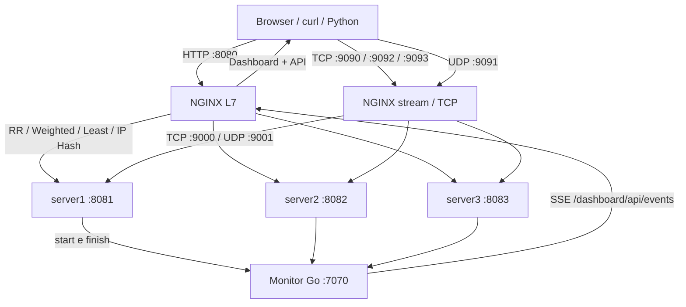

# Laboratório de Load Balancing: NGINX + Go + Docker

## Algoritmos de Load Balancing

### 1. Round Robin (RR)
Distribui as requisições sequencialmente entre os servidores, alternando entre Server 1, Server 2 e Server 3. 
É indicado quando os servidores possuem capacidades semelhantes e as requisições apresentam custos de processamento parecidos.

### 2. Weighted Round Robin (WRR)
Distribui as requisições conforme os pesos atribuídos a cada servidor. 
No laboratório, utilizamos pesos **5:3:1**, permitindo que servidores com maior capacidade recebam proporcionalmente mais tráfego.

### 3. Least Connections
Encaminha novas requisições ao servidor com o menor número de conexões ativas. 
É indicado para aplicações com requisições de durações diferentes, ajudando a evitar sobrecarga em servidores ocupados.

### 4. IP Hash
Utiliza o endereço IP do cliente para determinar qual servidor receberá suas requisições. 
É útil para manter afinidade entre cliente e servidor (*session affinity*), embora não garanta persistência absoluta da sessão.

## Camadas de balanceamento

### 5. Layer 4 (L4 — Transporte)
Realiza o balanceamento considerando informações de rede e transporte, como endereços IP e portas TCP/UDP, sem interpretar o conteúdo HTTP.
 É indicado para serviços que utilizam protocolos de transporte diretamente.

### 6. Layer 7 (L7 — Aplicação)
Realiza o balanceamento considerando informações HTTP, como URL, caminho, cabeçalhos e cookies. 
Permite roteamento inteligente por serviço ou endpoint, sendo amplamente utilizado em APIs, microsserviços e aplicações web.

**Destinado a macOS Big Sur 11.7.11 (Mac Intel) com Docker Engine acessível e Docker Compose V2.** Um laboratório completo de escalabilidade horizontal, com 3 servidores Go, NGINX L7/L4 e um **dashboard observável em tempo real**. Sem dependências JavaScript externas nem bibliotecas Go de terceiros.

> **Objetivo:** entrar em **`http://localhost:8080`**, disparar uma ou várias requisições e **ver graficamente** qual instância recebeu cada uma. Além de HTTP, é possível executar TCP/UDP pelo terminal e observar esses resultados no mesmo painel. `8081`, `8082` e `8083` identificam as portas HTTP dos três servidores.

## 1. Arquitetura



**Cinco containers:** `nginx`, `monitor`, `server1`, `server2`, `server3`. As três instâncias executam **o mesmo binário Go** com variáveis de ambiente diferentes. Isso é escalabilidade horizontal. O `monitor` recebe eventos dos backends e disponibiliza um stream **Server-Sent Events (SSE)** consumido pelo navegador. Todas as métricas ficam **em memória** (reiniciar o monitor zera o histórico).

| Acesso no Mac | Destino / função | Camada |
|---|---|---|
| `http://localhost:8080` | Dashboard e entrada HTTP do NGINX | 7 |
| `http://localhost:8081` | Go `server1` (acesso direto, sem LB) | 7 |
| `http://localhost:8082` | Go `server2` (acesso direto, sem LB) | 7 |
| `http://localhost:8083` | Go `server3` (acesso direto, sem LB) | 7 |
| `127.0.0.1:9090` | TCP Round Robin | 4 |
| `127.0.0.1:9092` | TCP Least Connections | 4 |
| `127.0.0.1:9093` | TCP Weighted Round Robin | 4 |
| `127.0.0.1:9091/udp` | UDP Round Robin | 4 |

Os serviços expõem portas **somente em `127.0.0.1`** para não publicar o laboratório na rede doméstica. Dentro da rede do Docker, o HTTP de cada backend usa `8081/8082/8083`; TCP usa `9000` e UDP usa `9001` em **cada container**, evitando conflitos porque cada container tem seu próprio namespace de rede.

## 2. Pré-requisitos (Mac Intel, macOS Big Sur 11.7.11)

**Docker Desktop atual não funciona no macOS 11.** Use o script se já possuir um Docker Desktop **legado e funcional** (por exemplo, da geração 4.24.x) ou um Docker Engine remoto acessível. A Docker não distribui oficialmente instaladores tão antigos; versões fora da janela de seis meses também não têm atualizações de segurança. Se ainda não tiver Docker funcionando nesse Mac, consulte [README_MAC.md](README_MAC.md) antes de tentar instalar.

Verifique o ambiente:

```bash
bash scripts/lab.sh doctor
docker version
docker compose version
```

Se usar Docker Desktop legado, abra o aplicativo **Docker** antes de executar `up`. O comando `docker info` deve funcionar sem erro. Não é preciso instalar Go ou NGINX no host; as imagens serão criadas pelos containers. Python 3 é necessário para os clientes de carga e TCP/UDP. **Não use `sudo docker` no Mac**.

> Como o Mac tem apenas 8 GB de RAM, reserve aproximadamente **2 GB de RAM e 2 CPUs** para a VM Docker, desative Kubernetes e evite iniciar vários laboratórios ao mesmo tempo. Comece com 30–50 requisições simultâneas no máximo. Esses valores são sugestões, não garantias de desempenho.

## 3. Iniciar e parar

Após descompactar o ZIP, abra o terminal **na pasta que contém `compose.yaml`**:

```bash
bash scripts/lab.sh up
```

Isso constrói as imagens e inicia os cinco containers. Depois abra:

**[http://localhost:8080](http://localhost:8080)**

Comandos úteis:

```bash
bash scripts/lab.sh ps              # containers
bash scripts/lab.sh check           # verifica NGINX e monitor
bash scripts/lab.sh logs nginx      # acessos e erros do balanceador
bash scripts/lab.sh logs server1    # logs de um backend
bash scripts/smoke_test.sh          # teste HTTP, TCP e UDP de ponta a ponta
bash scripts/lab.sh down            # encerra tudo
bash scripts/lab.sh doctor          # verifica Docker e macOS
bash scripts/lab.sh smoke           # testa HTTP, TCP e UDP
```

Se o painel não abrir na primeira tentativa, execute `bash scripts/lab.sh ps`, verifique os logs e aguarde os containers efetivamente iniciarem. Os comandos de execução pressupõem Docker ativo no host.

## 4. Como funciona a visualização gráfica

Na página `:8080` há **quatro áreas**:

1. **Gerador de tráfego HTTP:** selecione algoritmo, quantidade, concorrência e delay. Clique em **Enviar 1 requisição** (examina um request) ou **Executar carga** (geração concorrente).
2. **Três cartões de servidor:** o cartão que recebe um request pisca; cada cartão mostra `serverN`, porta `808N`, contagem acumulada, porcentagem e requests em processamento.
3. **Timeline + tabela:** cada alocação real aparece na linha do tempo, seguida de eventos `INÍCIO`/`FIM` com protocolo, modo e duração.
4. **Experimentos L4:** mostra comandos para TCP e UDP. Esses requests também aparecem automaticamente no gráfico se o painel estiver aberto.

Em **Filtrar resultados**, escolha um modo específico. O contador global sempre registra todos os requests; a distribuição por servidor considera apenas o filtro selecionado. O botão **Zerar métricas** zera os dados do monitor, permitindo uma comparação limpa entre estratégias. Não zere durante carga em andamento.

> A contagem reflete eventos enviados **pelos backends que realmente receberam as requisições**. Não é uma simulação visual de Round Robin: o **NGINX executa os algoritmos reais**. A telemetria é assíncrona e pode demorar frações de segundo para chegar aos gráficos. Falhas antes de atingir um backend não entram na contagem, mas aparecem no cliente/NGINX.

## 5. Algoritmos L7: explicação e testes

Para cada experimento, clique em **Zerar métricas**, selecione o algoritmo e **altere o filtro** para esse algoritmo antes de disparar carga. Alternativamente, execute os comandos abaixo no terminal e acompanhe o painel aberto no navegador.

### 5.1 Round Robin — divisão igualitária

**Como funciona:** NGINX alterna as novas requisições entre os três membros do `upstream`. Sem pesos, a distribuição tende a ser 1:1:1.

**NGINX:** `upstream http_rr { server server1:8081; server server2:8082; server server3:8083; }`

**Rota:** `GET http://localhost:8080/rr/api/visit` (também disponível em `/api/visit`).

```bash
for i in $(seq 1 9); do curl -s http://localhost:8080/rr/api/visit; echo; done
# Ou carga estruturada:
python3 scripts/http_load.py --mode rr --count 36 --concurrency 6 --delay 100
```

**Observe:** os cartões se alternam e o gráfico tende a exibir **12 / 12 / 12** depois de 36 requisições. Em caso de indisponibilidade de algum servidor, os números mudam.

**Quando usar:** serviços sem estado com instâncias de capacidades semelhantes. **Trade-off:** não considera custo de cada request nem diferenças de capacidade.

### 5.2 Weighted Round Robin — capacidades diferentes

**Como funciona:** define pesos `server1=5`, `server2=3`, `server3=1`. A participação esperada de longo prazo é **55,6% / 33,3% / 11,1%**. Pesos não são garantias para cada pequena janela de requests.

**NGINX:** `server server1:8081 weight=5;` e equivalentes para `3` e `1`.

**Rota:** `GET http://localhost:8080/weighted/api/visit`.

```bash
python3 scripts/http_load.py --mode weighted --count 90 --concurrency 6 --delay 100
```

**Observe:** um teste de 90 requests deve se aproximar de **50 / 30 / 10**. Use o filtro HTTP Weighted. Os cartões do server1 crescerão mais.

**Quando usar:** nós com capacidades diferentes, migrações graduais e canary (com cuidado). **Trade-off:** pesos são configurados; não medem automaticamente latência ou CPU.

### 5.3 Least Connections — conexões ativas

**Como funciona:** direciona novas requisições ao servidor com **menos conexões de upstream em andamento**. Não significa *menor latência*, *menor CPU* ou *menor número histórico de requisições*.

**NGINX:** `least_conn;` antes dos `server` no bloco `upstream http_least`.

**Rota:** `GET http://localhost:8080/least/api/visit`.

```bash
# Cenário A: sem lentidão assimétrica (pode parecer Round Robin)
python3 scripts/http_load.py --mode least --count 36 --concurrency 12 --delay 1000

# Cenário B: o server1 leva 3,5s, os outros 70ms
python3 scripts/http_load.py --mode least --count 48 --concurrency 12 --slow-server1
```

**Observe:** com `server1` lento, as novas conexões tendem a priorizar os outros dois, porque a primeira conexão fica ocupada mais tempo. Compare com Round Robin sob **a mesma carga**:

```bash
python3 scripts/http_load.py --mode rr --count 48 --concurrency 12 --slow-server1
```

No painel é possível fazer tudo pelo checkbox **Simular server1 lento**. **Trade-off:** mais adequado quando o tempo de processamento varia; conexões ativas ainda são uma aproximação da carga real e dependem de keep-alive e do protocolo.

### 5.4 IP Hash — afinidade por IP (extra)

**Como funciona:** NGINX faz o mapeamento do IP observado na borda para um backend, de modo que chamadas do mesmo IP tendem ao mesmo destino.

**Rota:** `GET http://localhost:8080/iphash/api/visit`.

```bash
python3 scripts/http_load.py --mode iphash --count 18 --concurrency 1
```

**Observe:** em testes locais é frequente todas as requisições serem encaminhadas ao **mesmo servidor**, porque chegam com o mesmo IP de origem ao NGINX. Isso **não é erro**. Não tente variar o IP por `X-Forwarded-For` esperando alterar esse `ip_hash`: o algoritmo configurado usa `$remote_addr` observado pelo NGINX, não esse cabeçalho. **Trade-off:** desequilíbrio quando muitos usuários compartilham NAT; não substitui sessões externas em sistemas distribuídos.

## 6. Camada 4: testes reais TCP e UDP

O módulo `stream` do NGINX controla os sockets de transporte e **não interpreta a rota HTTP**. O cliente Python envia uma única mensagem por conexão TCP, e para UDP envia um datagrama e espera uma resposta. Cada backend inclui `serverN` e `port=808N` na resposta e reporta o evento ao monitor.

### 6.1 TCP Round Robin — porta 9090

```bash
python3 scripts/l4_client.py --protocol tcp --port 9090 --count 18
```

**Observe:** 18 conexões TCP aproximadamente 6 / 6 / 6, filtro **TCP Round Robin**. Cada request estabelece **uma conexão**, envia uma linha e recebe a resposta, para distinguir conexão de requisição HTTP.

### 6.2 TCP Least Connections — porta 9092

```bash
python3 scripts/l4_client.py --protocol tcp --port 9092 --count 24 --concurrency 12 --delay 1800
```

**Observe:** conexões simultâneas ocupadas durante 1,8 s, contadores de `ativos` subindo; novas conexões vão para destinos com menos conexões. Como a demora é **idêntica nos três servidores**, a distribuição pode continuar parecida com 1:1:1.

### 6.3 TCP Weighted Round Robin — porta 9093

```bash
python3 scripts/l4_client.py --protocol tcp --port 9093 --count 90
```

**Observe:** proporção aproximada **50 / 30 / 10** nas conexões TCP.

### 6.4 UDP Round Robin — porta 9091/udp

```bash
python3 scripts/l4_client.py --protocol udp --port 9091 --count 18
```

**Observe:** respostas UDP dos três servidores. O cliente usa um socket UDP novo em cada envio e o NGINX configura `proxy_responses 1` para obter uma troca simples de datagrama e resposta. Se usar o mesmo socket persistentemente, o comportamento do fluxo UDP pode mudar porque o NGINX rastreia sessões pseudo-conectadas para datagramas.

**Importante sobre rótulos L4:** o campo `mode=tcp-least` enviado pelo cliente serve somente para categorizar eventos; é a **porta de entrada do NGINX** que realmente determina qual `upstream` será usado. O navegador não envia pacotes TCP/UDP brutos; os testes L4 precisam do terminal.

## 7. Experimento de falha, escalabilidade e alto volume

### 7.1 Desligar uma instância e observar resiliência

```bash
bash scripts/lab.sh ps
# Localize o container de server3 e substitua abaixo pelo nome real:
docker compose -f compose.yaml stop server3
# Faça 30 requests e veja qual resposta/erro ocorre:
python3 scripts/http_load.py --mode rr --count 30 --concurrency 3
# Reative o container:
docker compose -f compose.yaml start server3
```

O NGINX Open Source fornece **health check passivo** (p.ex. `max_fails` e `fail_timeout` nos grupos RR). Você pode observar erros transitórios quando o backend cai antes de o balanceador identificá-lo como indisponível. Os backends sem os parâmetros explicitados também usam parâmetros passivos padrão. **Não é uma demonstração de zero downtime nem prova de alta disponibilidade completa.**

### 7.2 Milhares de usuários simultâneos: o que acontece?

Para testes **moderados** no notebook (não comece com milhares), faça:

```bash
python3 scripts/http_load.py --mode rr --count 300 --concurrency 30 --delay 200
```

Observe contadores, latência média, P95 amostral, eventuais falhas e diferença entre duração total e quantidade de requests. Em grande volume os gargalos podem ser CPU, RAM, filas, sockets, timeout, sistema operacional, conexões abertas, overhead de instrumentação e o próprio NGINX. O painel guarda os últimos 250 eventos na timeline/tabela, mas os **contadores são acumulados**. O laboratório **não** mede RPS de produção nem executa auto-scaling.

### 7.3 Vertical x horizontal

- **Vertical (scale up):** aumentar CPU/RAM de uma única instância. Ex.: dar mais CPUs ou memória para `server1` no runtime (sem criar instâncias). **Limite:** capacidade da máquina e ponto único de falha se houver apenas uma réplica.
- **Horizontal (scale out):** três cópias da mesma aplicação, independentes, distribuídas atrás do balanceador — **é o que este projeto demonstra**. **Custo:** coordenação, observabilidade e compartilhamento seguro de estado, se houver.

Se quiser explorar escalonamento além de 3 instâncias, será preciso alterar `compose.yaml` **e** os `upstream` no NGINX. Isso é manual, **não auto-scaling**. A arquitetura atual propositalmente mantém **3 backends identificáveis**.

## 8. Camadas OSI e diferença entre L4 e L7

| Característica | L4 — TCP/UDP (`stream`) | L7 — HTTP (`http`) |
|---|---|---|
| Objeto roteado | conexão TCP ou fluxo de datagramas UDP | requisição HTTP |
| Lê rota `/api/visit`? | Não | Sim |
| Algoritmos no lab | RR, Weighted TCP, Least TCP; RR UDP | RR, Weighted, Least, IP Hash |
| Entrada externa | 9090, 9092, 9093 TCP; 9091 UDP | **8080 HTTP** |
| Exemplo real | tráfego de banco de dados, TCP genérico, serviços UDP | aplicações web, APIs REST |
| Vantagem | funciona com diversos protocolos de transporte | permite roteamento por rota, headers, host etc. |
| Custo / limitação | sem semântica HTTP | overhead de processamento HTTP e maior acoplamento ao protocolo |

**Modelo OSI (atalho prático):** L4 = Transporte; L7 = Aplicação. Em uma API REST, HTTP está na camada de aplicação, normalmente sobre TCP e TLS. NGINX também pode receber tráfego HTTP/3 sobre QUIC (UDP) em configurações apropriadas, **mas isso não é implementado aqui**.

## 9. Arquivos do projeto

```text
laboratorio-balanceamento-nginx-go-docker-mac/
├── compose.yaml             # 5 containers e portas localhost
├── nginx/
│   ├── Dockerfile           # Alpine + NGINX + módulo stream
│   ├── nginx.conf           # upstreams L7 e L4
│   └── proxy-common.conf    # parâmetros do proxy HTTP
├── service/
│   ├── Dockerfile           # Go multi-stage (sem libs de terceiros)
│   ├── go.mod
│   ├── main.go              # entrada por ROLE
│   ├── backend.go           # API HTTP + servidor TCP + UDP
│   ├── monitor.go           # contadores, histórico, SSE e dashboard
│   ├── lab_test.go          # testes unitários
│   └── web/
│       ├── index.html       # UI em http://localhost:8080
│       ├── style.css
│       └── app.js
├── scripts/
│   ├── lab.sh               # inicia, verifica, encerra
│   ├── http_load.py         # carga HTTP + resumo de distribuição
│   ├── l4_client.py         # cliente TCP/UDP + contagem por backend
│   └── smoke_test.sh        # teste integrado
└── docs/
    └── ARQUITETURA.md       # explicações de trade-offs, métricas e falhas
```

## 10. Verificações e solução de problemas

- **Porta já utilizada:** `lsof -nP -iTCP -sTCP:LISTEN | grep -E ':(8080|8081|8082|8083|9090|9092|9093)'` e `lsof -nP -iUDP:9091`. Pare o processo conflitante ou mude o lado esquerdo do binding em `compose.yaml` e adapte os clientes.
- **NGINX não inicia:** verifique `bash scripts/lab.sh logs nginx`. Se o erro for de `ngx_stream_module`, confirme que a imagem foi construída com `nginx-mod-stream` (veja `nginx/Dockerfile`).
- **Erro 502:** um backend pode não ter iniciado; confira `bash scripts/lab.sh ps` e os logs do serviço. A ordem de subida dos containers não garante prontidão instantânea.
- **Painel abre mas contadores não mexem:** verifique `bash scripts/lab.sh logs monitor`. Os backends enviam eventos HTTP internos para `http://monitor:7070/internal/event`.
- **Os gráficos não atualizam:** em Ferramentas de Desenvolvedor, inspecione a conexão `GET /dashboard/api/events` (SSE). Se ficar sem conexão, veja os logs do monitor.
- **`docker compose` não funciona:** confirme que Docker Compose V2 está instalado: `docker compose version`. Não use Compose V1.
- **`iphash` cai num único servidor:** é comportamento esperado quando o IP de origem do cliente é igual.
- **Least parece igual a RR:** use **concurrência > 1** e simule o `server1` lento. Com requests muito rápidos, todas as conexões ficam livres antes de chegar a próxima.
- **Go e front-end:** `cd service && go test ./...`; `node --check service/web/app.js` se tiver Node instalado.

**Segurança:** projeto para aprendizado, não para produção. A API de métricas e reset não tem autenticação; por isso as portas são restritas ao loopback. Não publique o ambiente na Internet. Não há TLS, circuit breaking, health checks ativos, auto-scaling, persistência das métricas nem SLOs de produção.

## 11. Fontes oficiais

- NGINX HTTP Load Balancing: https://nginx.org/en/docs/http/load_balancing.html
- NGINX TCP/UDP Load Balancing: https://docs.nginx.com/nginx/admin-guide/load-balancer/tcp-udp-load-balancer/
- NGINX stream module: https://nginx.org/en/docs/stream/ngx_stream_core_module.html
- Docker Compose: https://docs.docker.com/compose/
- Docker no macOS: https://docs.docker.com/desktop/setup/install/mac-install/
